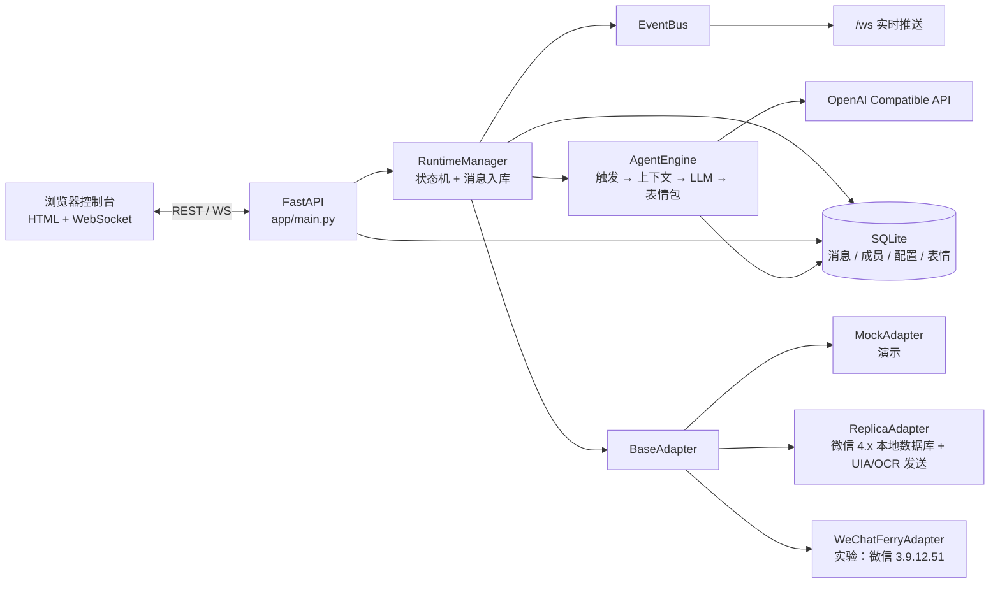

# 群伴 · WeChat Group Agent

一个可拓展的微信群聊 Agent 服务：扫码登录微信、实时读取群消息与成员昵称、按人设自动接话，并且能自己挑表情包发出去。

- **后端**：FastAPI + SQLAlchemy + SQLite，WebSocket 实时推送
- **前端**：原生 HTML/CSS/JS 控制台，无需前端构建
- **适配器**：演示模式；Windows 真实微信使用「微信 4.x（wechatauto-replica）」本地数据库读取 + UIA/OCR 发送，WeChatFerry 仅保留为实验备选
- **模型**：任意 OpenAI Compatible API（DeepSeek / OpenAI / Moonshot / Qwen / Ollama…）；每个群伴用户自己配置 Base URL、Key 和模型，仓库不内置任何 Key
- **表情包**：内置示例 + 上传 PNG/JPG/GIF/WEBP，模型按标签与语境自动选择
- **可拓展**：适配器、事件总线、触发规则、人设、表情库均解耦

> 个人微信自动化存在平台风控与封号风险，请使用小号测试，并控制回复频率。
> 本项目默认只监听 `127.0.0.1`，没有内置登录鉴权，不要直接暴露到公网。

---

## 1. 功能一览

| 能力 | 说明 |
| --- | --- |
| 扫码登录 | 演示模式生成二维码；真实微信把登录二维码控件实时显示在网页里 |
| 实时群聊 | WebSocket 推送新消息、群成员、Agent 状态、输入中提示 |
| 群级双开关 | 每个群独立控制「读取消息 / 自动回复」；关闭读取就不读新消息，读取开但回复关就是只读 |
| 置顶当前聊天 | 只允许一个置顶群；置顶后自动开启读取，并按 1 秒间隔读取该群新消息（不会在微信里打开群聊） |
| 聊天记录 | SQLite 持久化；从微信 4.x 本地数据库同步最近记录 |
| 昵称解析 | 群列表、群成员、消息发送者昵称；读取微信数据库中的昵称和备注 |
| Agent 触发 | `@ 提及` / `关键词` / `所有消息`，支持概率、冷却、每小时上限、静默时段 |
| 人设配置 | 全局默认人设 + 每个群独立人设，可覆盖模型 |
| 表情包 | 上传、标签、描述、使用次数；模型输出 `sticker` 字段自动选择 |
| 手动发送 | 在控制台以账号身份发文字或表情包 |
| 演示模式 | 无需微信即可体验完整登录、群聊、Agent 回复、表情包流程 |
| 可拓展 | 适配器接口、事件总线、服务分层；新增协议或触发规则不需要改前端 |

---

## 隐私与数据

- `data/`、`wechatauto_logs/`、`.env`、数据库、二维码、日志、B站 Cookie 和本地媒体都已加入 `.gitignore`，不要提交。
- 仓库只包含源码、示例配置和文档；真实微信账号、群名、联系人、聊天记录不应进入 Git。
- 首次运行会生成 `data/agent.db` 和本地媒体目录；换机器部署时请重新登录微信/B站，不要复制旧数据库。
- `vendor/wxauto` 为第三方 MIT 许可代码，保留其 `LICENSE`。

---

## 1.1 Agent 助手 / 能力开关 / 联系人管理员

「助手」选项卡是一个可直接下命令的 Operator Agent。Operator 默认由 GitHub 官方 [OpenCode](https://github.com/anomalyco/opencode) 运行时执行，群伴不再复刻 agent loop：

- **官方 OpenCode**：群伴启动 `opencode serve`，通过 OpenCode 会话、原生 tool calling、事件流和中断机制执行任务；设置页/OpenCode 面板可切回内置循环兜底。模型请求只使用群伴设置里每个用户自己的 Base URL / API Key / 模型，不读取 OpenCode 官方账号或内置 Key。
- **群伴工具**：微信、B站、记忆、文件、终端等能力通过本地 MCP server 暴露给 OpenCode，并注册为独立工具（如 `qunban_read_file`、`qunban_run_powershell`）；群伴 MCP 项目、技能和接口分别通过 `qunban_run_mcp`、`qunban_run_skill`、`qunban_call_interface` 调用。工具调用仍经过群伴的 capability 权限网关。
- **微信发送**：只走 wechatauto-replica 的 `send_group_message` / `send_contact_message`；OpenCode 默认不注册 `keyboard_*` / `mouse_*`，并拦截包含微信操作关键词的 `run_powershell`。发送前会先打开目标会话并确认输入框，确认不了就取消，避免盲打键盘或卡死微信。
- **工具/插件展示**：OpenCode 面板展示 OpenCode 内置工具、群伴 MCP 工具、MCP 连接状态和 `data/opencode/plugins/` 下的插件。群伴原生工具清单在 `data/opencode/tools.json`，OpenCode 可通过 `qunban_tool_admin` 新增别名、改描述、停用/启用、删除和同步工具；也可以把新脚本写到 `data/opencode/tools/`，用 `handler_type="script"` 注册成真正的新工具，无需改 Python 主程序。


- 文件读写、PowerShell（可选 UAC 管理员）、HTTP 接口、技能、MCP、自我迭代任务。
- 能力列表分「助手 / 群聊」两列开关；技能、MCP、接口从工作区自动发现。
- 桌面能力：截屏、屏幕 OCR、鼠标移动/点击/拖拽/滚动、键盘输入/快捷键。
- 图片：助手支持上传图片并 OCR；Agent 可直接读图、在对话中返回图片。
- 截图：`screen_capture` / MCP 截图会自动在对话中内联显示；管理员私聊会把截图作为微信图片发送，而不是只发链接。
- 最大调用步数：助手页顶部可直接输入；默认 `0 = 不限制`，仍保留 500 步 / 30 分钟安全上限，防止死循环。设置页也可修改。
- OCR：优先使用 RapidOCR（GitHub 8.1k star，PaddleOCR PP-OCR 模型 + ONNX Runtime，完全离线）；未安装时回退 Windows OCR。安装入口见 `requirements-ocr.txt`，也可选装 PaddleOCR。
- 管理员启动：`start-admin.bat` / `start-admin.ps1`。

「会话」左侧新增「群聊 / 联系人」切换：

- 联系人读取自微信 4.x `contact.db`，可查看私聊、手动发送、设置管理员。
- 标记为管理员的联系人发来的微信私聊，会由 Agent 自动读取并通过微信回复；具备最高 `admin` 权限（含群管理工具）。
- 管理员私聊执行工具时，Agent 会先把「收到，我开始处理」和关键工具进度发到微信；同一任务中继续发消息会插入当前任务，发「停止 / 取消」可人工打断。
- 「助手 → 联系人」把联系人列表、私聊记录、发送框和 Agent 设置集中到一个面板：可设置触发方式（所有消息 / 关键词）、关键词、温度和专属人设；只有管理员会进入自动回复链路，普通联系人默认只展示。
- 私聊窗口可以直接点「Agent 设置」跳到助手选项卡的联系人设置面板；联系人聊天窗口不会因为点击背景而关闭。
- 消息会标记来源：「微信」表示来自微信，「本地」表示控制台手动发送，「微信 Agent」表示 Agent 通过微信发出的回复；本地 Agent 对话只在助手选项卡回复，微信来源才通过微信回复。
- 普通联系人只展示会话，不自动进入 Agent 回复链路。
- 图片/表情包/消息发送统一走 wechatauto-replica；图片在会话内显示，表情包只显示文字。

### 1.2 任务进度、连续消息与 B站

- **任务进度**：助手执行高复杂度任务时，会通过 WebSocket 推送「第 N 步、正在调用哪个工具、成功/失败」等关键节点，显示在对话框上方；工具调用记录仍会持久化。管理员私聊会同步收到精简的微信进度。
- **无人值守循环**：默认不限制步数，Agent 会持续「规划 → 调工具 → 看结果 → 继续」直到完成；用户可以随时点「停止」或在微信发「停止」打断，也可以在执行中继续发新要求，Agent 会合并处理。同一工具相同参数连续失败 3 次、或连续 5 次返回相同结果时，Agent 会自行停止并说明原因。
- **官方运行时**：Operator 直接使用 [anomalyco/opencode](https://github.com/anomalyco/opencode) 的会话与工具循环；不再在群伴里模仿 OpenCode。实现说明见 [docs/opencode.md](docs/opencode.md)。
- **连续消息**：群配置新增「允许连续发送多条消息」和最多条数（2–6）。模型可以输出文字 + 表情包混合的多段回复，Agent 会按顺序逐条发送。
- **主动发起**：群配置新增「安静后主动发起话题」和间隔分钟数（10–1440）。默认关闭，开启后只在群聊安静一段时间且不在静默时段时触发。
- **B站**：「助手 → B站」支持扫码登录、账号密码极验登录、Cookie 登录；登录后可搜索视频、打开观看、点赞、评论、刷推荐。Agent 也可通过 `bili_search` / `bili_watch` / `bili_like` / `bili_comment` / `bili_feed` 等工具自主调用。
- **自动刷 B站**：在「助手 → B站」开启后，Agent 会自行选择主题和视频、转写音频、理解内容，并按自己的判断决定是否点赞/收藏/评论/回复评论；兴趣关键词可以留空，由 Agent 按自己的喜好选择。不会默认对每个视频三连，操作可以全部不做。面板会实时显示完整过程。看完视频后会生成 Agent 自己的 `opinion`；如果决定评论，评论通过群伴的 `bili_comment` 工具发出，模型没写评论正文时会直接用 `opinion`。Agent 也可以先调用 `bili_last_opinion` 读取最近看法，再调用 `bili_comment`。
- **登录有效性**：`/api/bili/status` 会真实调用 B站校验 SESSDATA；过期时显示「登录已失效」，点赞/收藏/评论/回复会返回明确提示，不再只报 `-101` 或假装成功。
- **Cookie 持久化**：扫码登录成功后会把完整 Cookie（`SESSDATA`、`bili_jct`、`buvid3`、`buvid4`、`DedeUserID`、`ac_time_value` 以及 `buvid_fp`、`b_nut`、`sid` 等额外字段）保存到本地 `bili_accounts.cookie_json`，重启服务后自动复用；原始 Cookie 不会返回前端，只在本地数据库和接口请求中使用。
- **音频转文字**：优先使用 B站字幕/AI 总结（需登录）；没有字幕时用 `faster-whisper`（small 模型，CPU）把下载的音频转成中文文本。模型默认从 hf-mirror 下载，首次使用会慢一些。
- **视频知识库**：转写文本、总结和主题会写入本地 **ChromaDB** 向量库，中文 embedding 使用 **BGE-small-zh-v1.5**（fastembed）。Agent 可以用 `bili_knowledge_search` 检索已刷过的视频内容。
- **按需记录**：手动查阅 B站视频时，可点视频行「记」按需转写并写入知识库；Agent 也可调用 `bili_knowledge_add` 只记录当前需要的视频，不必把每个看过的视频都入库。
- B站实现参考 [bilibili-api-python](https://github.com/Nemo2011/bilibili-api)（GitHub 高星 B站 API 库）；ASR 参考 [faster-whisper](https://github.com/SYSTRAN/faster-whisper) 与 [FunASR/SenseVoice](https://github.com/modelscope/FunASR)（中文场景更优的备选）；知识库使用 [ChromaDB](https://github.com/chroma-core/chroma)（约 2.7 万 star）。主动对话设计参考 [Thoughtful Agents](https://github.com/xybruceliu/thoughtful-agents) 与 Proactive Conversational Agents（Inner Thoughts）的思路。
- B站自动化可能受平台风控和社区规则限制，请只用自己的账号并控制频率；不要用于刷量、营销或骚扰。

---

## 2. 架构



消息链路：

```text
微信/演示适配器
  → RuntimeManager 事件队列（线程安全）
  → 去重、群/成员/消息入库
  → WebSocket 推送到前端
  → 命中触发规则时交给 AgentEngine
  → 读取上下文 + 表情库 → 调用 LLM
  → 解析 JSON → 适配器发送文字/表情
  → 入库并通过 WebSocket 回显
```

详细设计见 [docs/ARCHITECTURE.md](docs/ARCHITECTURE.md)。

---

## 3. 快速开始（Windows）

### 方式 A：双击启动

```text
双击 start.bat
```

首次运行会自动创建 `.venv`、安装依赖，然后打开 `http://127.0.0.1:8000`。

### 方式 B：手动启动

需要 64 位 Python 3.11+（微信 4.x 适配器建议使用 3.11 / 3.12）：

```powershell
cd "C:\path\to\wechat-group-agent"
py -3.12 -m venv .venv
.\.venv\Scripts\Activate.ps1
python -m pip install --upgrade pip
python -m pip install -r requirements.txt
# 微信 4.x 读取与发送：
python -m pip install -r requirements-replica.txt
# 推荐的高精度离线 OCR：
python -m pip install -r requirements-ocr.txt
# 官方 OpenCode（从 GitHub Release 下载，首次安装一次）：
powershell -ExecutionPolicy Bypass -File .\scripts\setup-opencode.ps1
python -m uvicorn app.main:app --host 127.0.0.1 --port 8000
```

浏览器打开：

```text
http://127.0.0.1:8000
```

macOS / Linux 可使用 `./start.sh`（演示模式或自定义适配器；WCF 仅 Windows）。

### 后台运行

```powershell
powershell -ExecutionPolicy Bypass -File .\start-background.ps1
```

真实微信（WeChatFerry）通常可以直接以当前用户启动；如果遇到注入权限错误，使用：

```text
start-wcf.bat
```

它会弹出 UAC，确认后以管理员身份用 `.venv312` 启动服务。停止仍使用 `stop-background.ps1`。

停止：

```powershell
powershell -ExecutionPolicy Bypass -File .\stop-background.ps1
```

后台日志在 `data/server.log`（应用日志）以及 `data/server.out.log` / `data/server.err.log`（进程输出）。

---

## 4. 演示模式：先跑通完整流程

1. 打开控制台，选择 **演示模式**，点击「开始扫码登录」。
2. 页面会显示演示二维码，几秒后自动确认登录。
3. 登录后会自动进入「产品摸鱼群」，并同步 5 个模拟群成员与历史消息。
4. 约 8 秒后，模拟群友会发一条 `@小助手` 消息；Agent 会读取上下文并回复，可能附带一个表情包。
5. 在输入框发送文字，或点输入框左侧笑脸发送表情包。
6. 在右侧「群聊控制台」切换触发方式、修改人设、调整冷却时间。
7. 在「设置」页填写大模型 API Key，即可切换为真实 LLM 回复。

演示适配器不需要微信，也不会向真实微信发送任何消息。

---

## 5. 接入真实微信（Windows）

### 5.1 真实微信适配器

| 适配器 | 原理 | 适用客户端 | 推荐度 |
| --- | --- | --- | --- |
| **微信 4.x（wechatauto-replica）** | 解密本地 SQLCipher 数据库读取；UIA/OCR 发送 | 微信 / Weixin 4.1.12+ | **推荐** |
| 微信 PC（WeChatFerry） | 注入 `wcferry` / `spy.dll` 协议层 | 仅匹配 3.9.12.51（WCF v39.5.2） | 实验性 |
| 演示模式 | 内置模拟群与消息 | 无 | 仅体验 |

微信 4.x（wechatauto-replica）适配器：

- 群列表、群成员、联系人、群聊和私聊记录都直接读本地数据库，不搜索微信窗口或通讯录。
- 支持扫码登录、实时消息、发送文字/图片/文件/表情包；发送使用 replica 的 `SendMsg` / `SendFiles` / `send_image`。
- 图片会解密后内联显示；表情包不下载，只显示「表情包」。
- 群名包含 `@chatroom` 或原始 ID 的过期临时群会被过滤：不展示、不记录、不自动回复。
- 微信必须保持登录；发送消息时窗口可能短暂切到前台，但不会抢占鼠标键盘。
- 仅支持 Windows。

### 5.2 安装（微信 4.x + wechatauto-replica）

1. 安装 64 位 Python 3.11 或 3.12（本机已准备 `.venv312`）。
2. 安装微信 / Weixin **4.1.12 或更高版本**（本机 4.1.15.13）。
3. 安装依赖：

```powershell
.\.venv312\Scripts\python.exe -m pip install -r requirements.txt
.\.venv312\Scripts\python.exe -m pip install -r requirements-replica.txt
.\.venv312\Scripts\python.exe -m pip install -r requirements-ocr.txt
.\.venv312\Scripts\python.exe -m pip install -r requirements-bilibili.txt
# 可选：Mem0 语义记忆（未安装时自动回退 SQLite）
.\.venv312\Scripts\python.exe -m pip install -r requirements-memory.txt
```

最后一行是推荐的高精度离线 OCR（RapidOCR）；不安装时会回退到 Windows OCR。

4. 启动控制台（`start.bat` / `start-background.ps1` 会优先使用 `.venv312`）：

```powershell
.\.venv312\Scripts\python.exe -m uvicorn app.main:app --host 127.0.0.1 --port 8000
```

5. 打开网页，选择 **微信 4.x（wechatauto-replica）**，点击「开始扫码登录」。
   - 程序会定位微信数据目录并识别当前账号
   - 网页会实时显示微信登录窗口里的二维码，用手机扫码即可
   - 登录成功后自动同步群聊、联系人和最近消息

#### 5.2.1 本地数据库模式说明

- 群聊、联系人、群成员和聊天记录来自 `xwechat_files/.../db_storage`；数据库需要解密，首次登录会自动定位目录，也可以在「设置 → 微信 4.x 数据库目录」手动指定。
- 只读取当前登录账号的数据；切换账号后需要重新登录。
- 名称包含 `@chatroom` 或原始 ID 的过期临时群会被过滤，不展示、不记录、不自动回复。
- 全局默认读取间隔为 1 秒，每个群独立计时；只有开启读取的群才会入库。
- 置顶只影响读取调度，不会在微信里搜索或打开群聊。
- 图片通过 `MediaDownloader` 解密后内联显示；表情包不下载，只显示「表情包」。
- 发送文字/图片/文件/表情包统一走 `wechatauto-replica`；发送失败时会先核对数据库，避免重复发送。
- 完整屏幕/键鼠控制需要以管理员身份启动：`start-admin.bat` 或 `start-admin.ps1`。

### 5.3 关于二维码

微信 4.x 适配器在登录前就可以读取微信登录窗口，因此二维码直接来自微信的「二维码」控件，并实时显示在网页里。如果二维码区域没有出现：

- 确认微信登录窗口已经打开并且没有被其他窗口完全遮住
- 点击「刷新群列表」或退出登录后重新连接
- 也可以直接在电脑上的微信登录窗口扫码，登录成功后控制台会自动进入

### 5.4 群配置

- 新同步的真实群默认 **关闭 Agent**，需要到右侧「群聊控制台」手动启用。
- 触发方式默认是「@ 提及时回复」。如果你在群里的昵称与账号昵称不同，把别名填到「设置 → Bot 别名」。
- 建议先设置：
  - 冷却 `30–60 秒`
  - 每小时上限 `10–30 条`
  - 静默时段（例如 `23:30` 到 `08:00`）
- 真实群聊建议先用小号/测试群验证。

### 5.5 微信 3.9 / WeChatFerry 旧环境（可选）

当前默认推荐微信 4.x + `wechatauto-replica`。以下内容仅适用于仍需使用微信 3.9 + WeChatFerry 的旧环境。

微信 3.9 是 32 位程序。在 64 位 Windows 上直接启动时，微信可能提示「版本过低」而拒绝登录。WCF 兼容启动会设置兼容层：

```text
__COMPAT_LAYER=~ ARM64WOWONAMD64
```

因此请让本服务启动微信（不要用普通快捷方式启动 3.9），或在项目目录运行：

```powershell
$key='HKCU:\SOFTWARE\Microsoft\Windows NT\CurrentVersion\AppCompatFlags\Layers'
New-Item -Path $key -Force | Out-Null
New-ItemProperty -Path $key -Name 'C:\Program Files\Tencent\WeChat\WeChat.exe' -Value '~ ARM64WOWONAMD64' -PropertyType String -Force
```

该方案来自 [WeChat3.9-32bit-Compatibility-Launcher](https://github.com/Skyler1n/WeChat3.9-32bit-Compatibility-Launcher)。如果不希望写入注册表，删除对应的 `Layers` 值即可。

### 5.6 常见问题

| 现象 | 处理 |
| --- | --- |
| 适配器显示「缺少 wechatauto-replica」 | 执行 `pip install -r requirements-replica.txt` |
| 找不到微信数据目录 | 确认微信 4.1.12+ 已登录；在「设置 → 微信 4.x 数据库目录」手动指定 `xwechat_files` |
| OCR 很慢或识别差 | 执行 `pip install -r requirements-ocr.txt` 安装 RapidOCR；不装会回退 Windows OCR |
| 二维码区域空白/黑屏 | 确认微信登录窗口可见；也可以直接扫描微信窗口中的二维码 |
| 登录后没有群 | 点「刷新群列表」；确认微信已登录；查看 `data/server.log` |
| 成员/聊天记录为空 | 选中群聊后会自动同步；确认该群已开启读取 |
| 发送失败 | 确认微信未退出、账号未掉线；replica 发送时微信窗口会被短暂切到前台 |
| 扫码后掉线 | 微信风控或多端登录可能导致；换小号或降低频率 |

> 个人微信自动化存在账号风险。请自行评估，不要用于骚扰、营销群发或违反平台规则的场景。

### 5.7 WeChatFerry（实验性备选）

WeChatFerry 适配器仍保留在项目中，适合已经固定使用微信 3.9.12.51 的环境：

```powershell
.\.venv312\Scripts\python.exe -m pip install -r requirements-wcf.txt
```

它需要微信 PC `3.9.12.51` 与 `wcferry 39.5.2.0`。**默认优先使用微信 4.x（wechatauto-replica）；WCF 仅作为固定 3.9.12.51 环境的备选。**

更详细的适配器对比与扩展方法见 [docs/WECHAT_ADAPTERS.md](docs/WECHAT_ADAPTERS.md)。

---

## 6. 配置大模型

进入「设置 → 模型接入」：

| 字段 | 示例 |
| --- | --- |
| API Base URL | `https://api.deepseek.com/v1` |
| 模型名称 | `deepseek-chat` |
| API Key | `sk-...` |
| 温度 | `0.8` |
| JSON 模式 | 开启（推荐） |
| 最大输出 tokens | `300` |
| 回复基础延迟 | `2.5` 秒 |
| 随机追加延迟 | `0–4` 秒 |
| 跨群最小间隔 | `8` 秒 |
| 额外随机冷却 | `20` 秒 |

兼容任意 OpenAI 格式的 `/chat/completions` 服务，例如：

- DeepSeek：`https://api.deepseek.com/v1`
- OpenAI：`https://api.openai.com/v1`
- Moonshot：`https://api.moonshot.cn/v1`
- 本地 Ollama：`http://127.0.0.1:11434/v1`（模型名如 `qwen2.5:7b`）

保存后点「测试连接」。如果模型不支持 `response_format`，后端会自动去掉该字段重试一次。

**没有配置 Key 时**，Agent 使用内置演示回复器，仍然可以体验触发、冷却、上下文和表情包选择。配置 Key 后自动切换真实模型。

API Key 保存在本地 SQLite 数据库（明文），请注意本机安全。

---

## 7. Agent 行为说明

每个群独立配置：

- **读取群消息**：关闭后完全不读取该群的新消息；群列表仍然保留，方便随时打开。
- **启用 Agent 自动回复**：必须同时开启读取；只开读取、不开回复就是「只读不回」。
- **触发方式**
  - `@ 提及`：消息包含 `@Bot昵称` 或设置中的别名
  - `关键词`：消息包含任意关键词
  - `所有消息`：每条文本消息都参与（配合概率/冷却使用）
- **触发概率**：0–100%，例如 30% 表示只有部分触发消息会真正调用模型。
- **回复节奏（随机限频）**：
  - 基础延迟默认 `2.5s` + 随机追加 `0–4s`
  - 连续触发先等待 `1–2.5s`，只让该群最新一条触发消息进入回复
  - 跨群最小发送间隔默认 `8s` + 随机 `0–4s`
  - 每次回复后群冷却 `cooldown_seconds` + 随机 `0–20s`
  - 接近每小时回复上限时会随机降频，不保证每条触发都回复
- **冷却/频率**：避免刷屏与模型费用失控。
- **静默时段**：支持跨午夜，例如 `23:30 → 08:00`。
- **人设**：留空使用全局默认；支持每群覆盖模型。
- **回复 @ 对方**：可选；开启后回复文字前会加 `@发送者`。
- **表情包**：模型读取表情库的 id、名称、标签、描述；在 JSON 中返回 `sticker`。
- **上下文**：默认读取最近 18 条群消息，包含昵称与时间，可在设置中调整。

模型必须输出类似：

```json
{"action": "reply", "reply": "收到，我看看", "sticker": "OK"}
```

或：

```json
{"action": "none"}
```

`sticker` 支持表情包 id、名称、标签；没有合适表情时填 `null`。解析失败或模型请求失败会记录到「Agent 动态」，不会向群里发送错误信息。

### 7.1 提示词与记忆注入

「设置 → 提示词与人设」提供以下可编辑项：

- **Operator 全局人设**：后台 Agent、管理员微信私聊每轮都会注入；联系人专属人设会叠加在它上面。
- **Operator 额外提示词**：追加在内置 Operator 提示词之后，优先级更高。
- **群聊 Agent 额外提示词**：追加到每个群的回复提示词；主动发起话题时也会带上。
- **记忆注入模板**：控制长期记忆如何进入上下文，支持 `{importance}`、`{category}`、`{title}`、`{content}`、`{scope}` 等占位符。
- **每次对话都注入最重要的长期记忆**：默认开启；即使当前消息没有关键词命中，也会带上最重要的记忆。
- **高级：覆盖 Operator / 群聊系统提示词**：留空使用内置提示词；填写后作为核心提示词，系统仍会追加人设、记忆、可用工具、表情包和 JSON 协议，避免破坏 Agent 调用。

群聊回复现在也会注入长期记忆（之前只有主动发起话题时带记忆）；Operator 的记忆除了按当前消息检索，还会额外合并最重要的长期记忆。

#### Mem0 语义记忆与遗忘

项目集成了 [Mem0 OSS](https://github.com/mem0ai/mem0)（GitHub 约 6 万 star）作为可选的长期记忆层：

- 记忆引擎：`auto`（Mem0 可用时优先）/ `mem0` / `sqlite`。
- Mem0 使用 DeepSeek 做事实提取，FastEmbed `BAAI/bge-small-zh-v1.5` 做中文向量，ChromaDB 本地持久化。
- 群聊总结批次会写入 Mem0，并带上 `group_id` / `group_name` 元数据；群聊回复检索时按群过滤。
- Operator 对话、管理员私聊会按 `scope=operator` / `scope=contact` 写入并检索。
- Mem0 自身的记忆衰减用于检索排序；另外每天最多执行一次旧记忆清理，默认清理超过 180 天的 1–4 星记忆，5 星记忆会保留，可在设置页手动执行。
- 未安装 Mem0 或调用失败时自动回退到原 SQLite 记忆，不影响聊天。

安装：

```powershell
.\.venv312\Scripts\python.exe -m pip install -r requirements-memory.txt
```

> Mem0 会调用 LLM 做记忆提取，产生额外模型费用；可以在设置页把记忆引擎切回 `sqlite` 关闭它。

---

## 8. 表情包

内置 6 个示例 PNG（启动时自动生成）：收到、笑死、点赞、摸鱼、晚安、问号。

- 打开「表情包」页，上传 PNG / JPG / GIF / WEBP（单张 ≤ 5MB）
- 填写名称、标签（逗号分隔）、描述。标签越准确，模型选择越准
- 点击卡片可发送到指定群
- 鼠标悬浮卡片可编辑/删除
- 界面自动化模式下，表情包会以图片形式发送到微信（微信界面没有稳定的指定表情包接口）；控制台仍记录为表情包
- GIF 会以原文件发送；不同适配器对 GIF 的呈现可能不同，必要时改用 PNG

服务启动时如果表情库为空，会自动生成示例。删除全部后可在页面点「补齐内置示例」重新生成。

---

## 9. 项目结构

```text
.
├── app/
│   ├── main.py                 # FastAPI 入口、生命周期、静态资源
│   ├── config.py               # 进程级配置（.env）
│   ├── db.py / models.py       # SQLite + SQLAlchemy
│   ├── schemas.py              # API 请求模型
│   ├── adapters/
│   │   ├── base.py             # 适配器抽象
│   │   ├── mock.py             # 演示适配器
│   │   ├── replica.py          # 微信 4.x 本地数据库 + UIA/OCR（推荐）
│   │   └── wcf.py              # WeChatFerry 适配器（实验）
│   ├── core/
│   │   ├── runtime.py          # 登录状态机、消息入库、发送
│   │   ├── agent.py            # 触发、上下文、LLM、表情选择
│   │   └── bus.py              # WebSocket 事件总线
│   ├── services/
│   │   ├── assistant.py        # Operator Agent 工具循环
│   │   ├── assistant_tools.py  # 文件 / PowerShell / 图片 / 技能工具
│   │   ├── bilibili.py         # B站登录、搜索、观看、ASR、点赞、评论
│   │   ├── bili_autopilot.py   # 自动刷 B站循环、分析、转发
│   │   ├── bili_knowledge.py   # ChromaDB B站视频知识库
│   │   ├── capabilities.py     # 能力发现与双作用域开关
│   │   ├── desktop.py          # 截屏、OCR、鼠标键盘
│   │   ├── memory.py           # 群聊长期记忆、总结、遗忘
│   │   ├── mem0_memory.py      # Mem0 语义记忆适配器（可选）
│   │   ├── llm.py              # OpenAI Compatible 客户端
│   │   ├── stickers.py         # 表情库、示例生成、上传
│   │   ├── settings.py         # 运行时设置
│   │   └── serializers.py      # API 序列化
│   └── api/                    # REST + WebSocket 路由
├── frontend/                   # 无构建控制台
├── docs/                       # 架构、适配器、API 文档
├── scripts/smoke_test.py       # 端到端自测
├── data/                       # 运行时生成：SQLite、表情文件、日志
├── requirements.txt
├── requirements-replica.txt
├── requirements-ocr.txt
├── requirements-bilibili.txt
├── requirements-memory.txt
├── requirements-wcf.txt
├── start.bat
├── start-background.ps1
├── start-admin.ps1
└── stop-background.ps1
```

---

## 10. API 与实时事件

启动后访问 `http://127.0.0.1:8000/api/docs` 查看自动生成的 OpenAPI 文档。

常用接口：

```text
GET    /api/status
POST   /api/login                 {"adapter":"mock"|"replica"|"wcf"}
GET    /api/login/qr
POST   /api/logout
GET    /api/groups
GET    /api/groups/{id}/messages?limit=80&before_id=
GET    /api/groups/{id}/members
POST   /api/groups/{id}/pin       # 置顶当前聊天（自动开启读取，只允许一个）
DELETE /api/groups/{id}/pin       # 取消置顶
PATCH  /api/groups/{id}/config
POST   /api/groups/{id}/send      {"text":"...","sticker_id":3}
GET    /api/groups/{id}/logs
GET    /api/stickers
POST   /api/stickers              multipart/form-data
PATCH  /api/stickers/{id}
DELETE /api/stickers/{id}
GET    /api/settings
PUT    /api/settings
POST   /api/settings/test-llm
GET    /api/contacts
PATCH  /api/contacts/{id}          {"is_admin":true,"trigger_mode":"all|keyword","keywords":"a,b","temperature":0.3,"persona":"..."}
GET    /api/contacts/{id}/messages
POST   /api/contacts/{id}/send     {"text":"..."}
POST   /api/assistant/chat         {"message":"...","attachment_path":"..."}
POST   /api/assistant/upload       multipart/form-data
GET    /api/capabilities
GET    /api/bili/status
POST   /api/bili/login/qr
GET    /api/bili/login/qr/{key}
POST   /api/bili/login/password/start
POST   /api/bili/login/password/poll
GET    /api/bili/search?q=&limit=
GET    /api/bili/recommend?limit=
POST   /api/bili/watch            {"bvid":"BV..."}
POST   /api/bili/like             {"bvid":"BV...","liked":true}
POST   /api/bili/comment          {"bvid":"BV...","text":"..."}
POST   /api/bili/feed             {"limit":5,"open_browser":true}
POST   /api/bili/transcribe       {"bvid":"BV...","model":"small"}
GET    /api/bili/comments?bvid=
POST   /api/bili/reply            {"bvid":"BV...","text":"...","root":123}
GET    /api/bili/autopilot
PUT    /api/bili/autopilot
POST   /api/bili/autopilot/run
GET    /api/bili/videos
GET    /api/bili/knowledge/search?q=
GET    /api/bili/knowledge/stats
GET    /api/stats
WS     /ws
```

WebSocket 事件：`hello`、`status`、`message.new`、`direct.message`、`contact.updated`、`groups.updated`、`members.updated`、`agent.typing`、`agent.log`、`adapter.log`、`adapter.error`、`settings.updated`。

详见 [docs/API.md](docs/API.md)。

---

## 11. 可拓展性

### 新增微信协议适配器

实现 `app/adapters/base.py` 的 `BaseAdapter`，在 `app/adapters/__init__.py` 注册即可：

```python
class MyAdapter(BaseAdapter):
    adapter_id = "my-protocol"
    display_name = "自定义协议"

    async def start(self): ...
    async def stop(self): ...
    async def send_text(self, room_id, text): ...
    async def send_sticker(self, room_id, path): ...
    async def list_groups(self): ...
    async def get_members(self, room_id): ...
```

适配器只需通过 `self.emit("message", ...)` 抛出标准消息事件，其余入库、WebSocket、Agent、表情库逻辑全部复用。

### 新增触发规则

在 `AgentEngine._triggered()` 中增加模式，并在前端 `cfg-trigger` 增加选项。群配置字段已按 JSON 存储，无需迁移。

### 接入工具调用 / 工作流

当前 Agent 使用 JSON 协议（兼容性最好）。若要扩展工具调用，可以在 `AgentEngine._generate_llm()` 前后增加工具循环，复用 `runtime.send_agent_message()` 与表情库服务；不需要修改适配器。

### 其他扩展方向

- 群聊总结 / 每日待办 / 定时播报（APScheduler）
- 向量记忆与长期偏好
- 联网搜索、知识库、MCP 工具
- 多账号 / 多适配器并存（当前 Runtime 为单活跃适配器，可扩展为多实例）
- Webhook、消息导出、审计日志

---

## 12. 数据与安全

- 数据目录：`data/agent.db`（SQLite）、`data/stickers/`（表情文件）、`data/server.*.log`
- 默认监听 `127.0.0.1`，无内置鉴权；如需远程访问，请在前面加带身份认证的反向代理并启用 HTTPS
- API Key 存在本地 SQLite，明文保存；不要把 `data/` 提交到公开仓库
- 上传文件限制 5MB，只允许 PNG/JPG/GIF/WEBP；文件名会重命名为 UUID
- 前端所有用户内容使用 `textContent` 渲染，避免 HTML 注入
- 个人微信自动化有账号风险；请遵守微信平台规则和当地法律法规

---

## 13. 自测

启动服务并切换到演示模式后，运行：

```powershell
.\.venv\Scripts\python.exe scripts\smoke_test.py
```

覆盖：健康检查、演示登录、群/成员同步、文本发送、表情发送、上传/编辑/删除、Agent 自动回复、群配置、设置、WebSocket。

```text
ALL SMOKE TESTS PASSED
```

---

## 14. 设计参考

本项目为独立实现，架构与交互设计参考了以下开源项目，未复制其代码：

- [WeChatFerry](https://github.com/lich0821/WeChatFerry) — Windows 微信 PC Hook / RPC
- [wxauto](https://github.com/cluic/wxauto) — Windows 微信 UI 自动化
- [Wechaty](https://github.com/wechaty/wechaty) — 多协议聊天机器人框架
- [chatgpt-on-wechat](https://github.com/zhayujie/chatgpt-on-wechat) — 微信 LLM 机器人实践
- [LangBot](https://github.com/RockChinQ/LangBot) — 多平台 Agent 机器人
- [WeChat3.9-32bit-Compatibility-Launcher](https://github.com/Skyler1n/WeChat3.9-32bit-Compatibility-Launcher) — 32 位微信 3.9 在 64 位 Windows 的兼容启动方案
- [Mem0](https://github.com/mem0ai/mem0) — 通用 Agent 记忆层（记忆提取、语义检索、衰减与遗忘）

---

## 15. 许可证与声明

仅用于个人学习、研究与效率工具。使用本项目造成的账号限制、数据丢失或其他损失由使用者自行承担。生产环境建议接入企业微信、公众号等官方 API。
